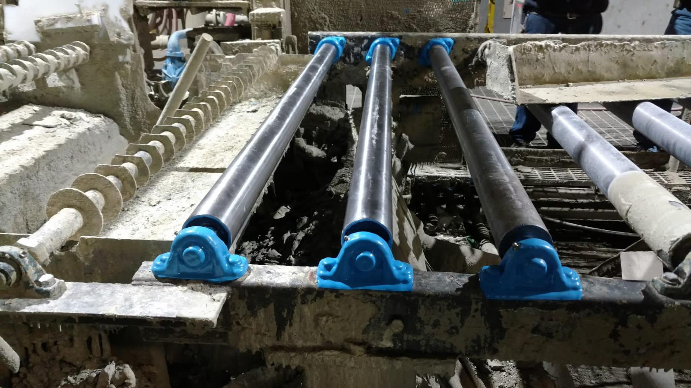

# Enviropeel Project

**A computer-vision quoting prototype for EP Industrial Coatings. Upload a photo of a bearing, flange, or gearbox, and it finds the closest past coating jobs and drafts a priced estimate: size, condition, coating system, labor, and materials.**



A coating quote usually starts with someone looking at a photo of the part and deciding what it is, how big it is, how rusted it is, and which system it needs. A generic image captioner is a weak guide to any of that, so this project uses one only as a last resort and treats quoting as retrieval plus arithmetic. It identifies the part by comparing it with labeled photos of coating work already done, borrows the matched jobs' size and type, reads rust and existing paint from pixel color, and then prices the job with explicit labor and material equations that end in a minimum job charge. Every step is visible in the output, so an estimator can see why a number came out the way it did.

```
photo  ->  CLIP ViT-B/32 embedding (int8 on CPU)  +  9-number visual signature
       ->  family scores: nearest labeled job per family (0.8) + text prompt per family (0.2)
       ->  rank coated catalog: 0.68 CLIP + 0.06 visual + 0.14 family + bonuses
       ->  top matches  ->  component type by weighted vote
       ->  size prior x matched size labels x fill, complexity, aspect  ->  surface area
       ->  rust / paint masks  ->  condition  ->  coating system
       ->  labor hours + gallons + consumables, minimum job charge  ->  estimate
```

Match the past job, then do the math in the open.

## The core idea

1. **Identify by precedent, not by caption.** The reference library is coated work, labeled by hand with a component family and a size note. A new photo is ranked against it with a hybrid score: CLIP image similarity, a small color and edge signature, and a family score that blends the nearest labeled example of each family with a text prompt describing that family.
2. **Size from a prior, not from pixels.** A single photo has no scale reference, so the estimate starts from typical dimensions for the identified component and nudges them by the matched jobs' size labels and by how much of the frame the object fills, then clamps to a plausible range.
3. **Price with equations an estimator would recognize.** Prep, primer, and finish hours per square foot, a setup allowance, coverage-based gallons with an 18% waste factor, consumables, and a minimum job charge per component type.

## What it does

| Feature | Route | Detail |
|---|---|---|
| **Identify** | `/`, `POST /api/upload` | Returns the top 3 coated catalog matches with rank score, CLIP similarity, predicted family, and that family's confidence. |
| **Estimate** | `/estimate`, `POST /api/estimate` | Component type, width x height x depth in inches, condition, complexity, surface area, recommended coating system, cost breakdown, and the 4 most similar past jobs. |
| **Coated catalog** | `GET /api/coatings/list` | Browse the labeled previous-work library. |
| **Add a reference** | `POST /api/reference/add` | Saves the photo with its family, coating status, and size note, writes a BLIP caption when no description is given, embeds it with CLIP, and reloads the matcher. Disabled on Vercel. |
| **Health check** | `GET /health` | For the Render deployment. |

The estimate model covers five component families, each with its own geometry, default size, coating system, and minimum charge (`estimate.py`):

| Component | Default size (in) | Coating system | Labor rate | Minimum charge |
|---|---|---|---|---|
| Pillow block bearing | 10.5 x 7.0 x 5.5 | Heavy-duty urethane | $95/h | $425 |
| Flange assembly | 14.0 x 10.0 x 4.0 | Zinc-rich primer + urethane topcoat | $95/h | $400 |
| Gearbox or drive housing | 18.0 x 15.0 x 12.0 | Heavy-duty urethane | $98/h | $575 |
| Bearing housing or support base | 16.0 x 14.0 x 8.0 | Heavy-duty urethane | $95/h | $450 |
| Support pedestal or mount base | 20.0 x 18.0 x 12.0 | Zinc-rich primer + urethane topcoat | $95/h | $525 |

A part read as badly rusted is switched to the zinc-rich system regardless of type.

## How it works

**Data.** The committed SQLite catalog (`instance/image_database.db`) holds 340 records. The matcher uses only the 136 that are coated and labeled: 8 source photos, six job photos in `reference_images/coatings/` and two Wikimedia Commons bearing photos, each stored with 16 augmented copies (flip, four rotations, three crops, two brightness, two contrast, two blur, two noise levels) from `build_robust_catalog.py`. Of those, 133 sit in the catalog split and 3 in the test split. The other 204 records are unlabeled general photos, mostly placeholder stock images from `populate_diverse_images.py`, and are filtered out of matching. Embeddings are stored in the database, so start-up does not re-encode the catalog.

**Matching.** `similarity.py` loads `openai/clip-vit-base-patch32`, applies dynamic int8 quantization to the linear layers when running on CPU, and L2-normalizes every embedding. Family scores combine the best cosine similarity to each labeled family (weight 0.8) with similarity to a text prompt for that family (weight 0.2), each min-max normalized. The rank score is 0.68 x CLIP cosine + 0.06 x visual-signature similarity + 0.14 x family score, plus 0.25 when a known file label agrees with the candidate's family and 0.02 for coated examples. Weights live in `similarity_config.json`, written by the grid search in `tune_similarity.py`.

**Condition and size.** `estimate.py` masks pixels by color: rust is red-dominant and saturated, existing coating is the blue, yellow, or white of finished work. More than 10% rust reads as poor and more than 4% as fair; more than 18% painted area reads as an existing coating. Edge density sets complexity. Dimensions start from the component's defaults, scale by matched size labels (large 1.18, small 0.84), object fill, complexity, and aspect ratio, and are clamped to each component's range. Surface area uses component-specific geometry, such as a face, edge, and pipe stub for a flange.

**Pricing.** Prep hours scale with condition (1.35 for poor, 1.15 for fair, 0.92 over an existing coating), primer and finish hours scale with complexity, and finish hours multiply by two coats. Gallons come from each system's coverage rate with an 18% waste factor. If the subtotal lands below the component's minimum charge, labor absorbs the difference.

**Serving.** Flask with SQLAlchemy and SQLite, two static pages, and CORS enabled. Uploads are converted to JPEG. Render runs it under gunicorn with one worker, two threads, and a 180-second timeout because the model is heavy; on Vercel the database is copied to `/tmp` and uploads are written there and not served back.

## Run it

```bash
pip install -r requirements.txt     # Python 3.12; first run downloads CLIP (and BLIP when captioning)
python app.py                       # http://localhost:5000, estimate page at /estimate
python test_all.py                  # database, routes, upload, and estimate smoke test
```

The committed database is ready to use. To rebuild or check the catalog: `migrate_db.py`, `assign_splits.py`, `seed_bearing_dataset.py`, `sync_catalog_metadata.py`, `build_robust_catalog.py`, and `download_industrial_images.py` (optional, Wikimedia Commons). `evaluate_dataset.py`, `robust_identification_eval.py`, and `audit_data_leakage.py` score the held-out split. `render.yaml` deploys to Render.

## Layout

```
app.py                      Flask routes: identify, estimate, catalog, add reference, health
similarity.py               CLIP matcher, visual signature, family scoring, hybrid ranking
similarity_config.json      tuned ranking weights
estimate.py                 component profiles, condition masks, sizing, surface area, pricing
catalog_metadata.py         hand labels for the source photos
caption.py                  BLIP captions for new references
database.py                 ImageRecord model, families, splits
runtime_config.py           local vs Vercel paths
static/                     index.html (identify, catalog, add) and estimate.html
instance/image_database.db  SQLite catalog with stored embeddings
assets/                     original job photos
reference_images/           coatings/ (job photos), downloads/ (Wikimedia), robust/ (augmented), stock photos
build_robust_catalog.py     16 augmentations per labeled photo
seed_bearing_dataset.py  download_industrial_images.py  populate_diverse_images.py   data loaders
assign_splits.py  migrate_db.py  sync_catalog_metadata.py  update_labels.py           maintenance
evaluate_dataset.py  robust_identification_eval.py  tune_similarity.py  audit_data_leakage.py   evaluation
test_all.py                 end-to-end smoke test
render.yaml  Procfile  vercel.json  run.sh   deployment
```

## Data

Only copyright-free images are included in this repository. The rest of the reference data was
sorted and labeled by hand and is not published here.
